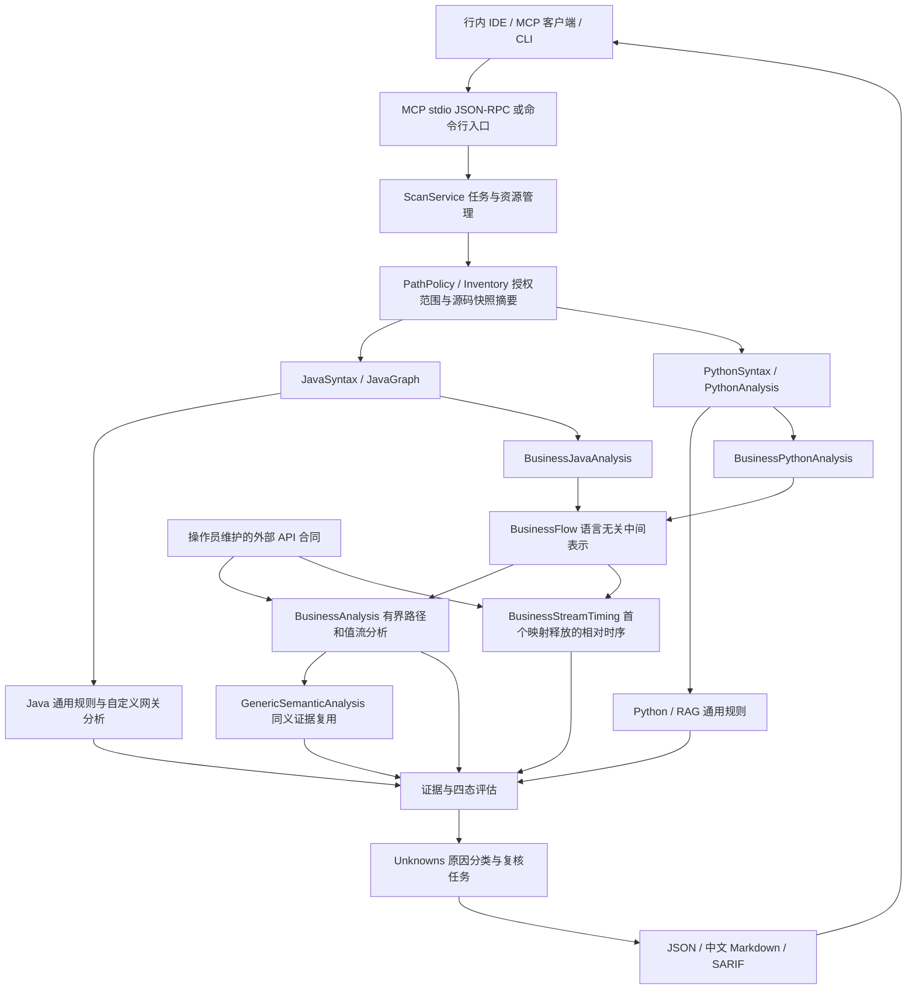

# AI Guardrail Scanner 技术实现方案

当前发行模块是 `compat/`，以 JDK 7 编译为可在 Java 7/8 运行的独立 JAR。它是源码与配置的本地静态审计服务：帮助研发和安全人员判断控制是否接入、是否绑定正确对象、是否存在未受保护路径，并给出证据与待确认事项。报告的 BLOCK 表示发现应阻止评审放行的问题；扫描器本身不代理模型请求，也不直接拦截生产流量。

## 1. 接入与任务管理

`Main` 提供 CLI 和 MCP 两种入口，复用同一 `Scanner`。MCP 由 `McpHost` 实现 stdio JSON-RPC，避免采用要求更新 JDK 的服务端依赖；目前没有 HTTP/SSE 远程服务端。兼容 MCP 的行内 IDE 可以按本地进程方式启动，也可由行内受控代理集成，但代理不属于当前实现。

五个 MCP 工具分别用于规则查询、启动扫描、查询状态、取消与取结果。客户端只能提交授权仓库路径，不能覆盖服务端启动时配置的规则包、外部合同或授权根目录。

`ScanService` 用单工作线程执行扫描并维护状态，限制任务历史、超时和文档缓存。报告先写入暂存文件，再核对取消、终态及缓存额度后发布，避免任务被取消后仍被标成完成。超出内联结果大小的报告通过本地文件交付；读取结果不重新分析目标应用。

## 2. 源码采集与解析

`PathPolicy` 检查授权目录和符号链接；`Inventory` 按文件/总字节/目录深度预算选择 Java、Python 和相关配置，跳过构建产物、依赖及测试目录，生成已纳入文件的 `sourceDigest`。扫描不会运行目标构建、导入 Python 模块、连接目标数据库或调用目标模型。

ANTLR 4.9.3 负责语法解析。Java 路径由 `JavaSyntax` 构造类型、方法、声明、表达式等节点，`JavaGraph` 建立有界调用关系并处理可解析的类型和重载；解析源码所支持的语法与扫描器自身 Java 7/8 运行要求是两个独立维度。

Python 路径解析导入、函数、客户端构造、字段接收者、关键字参数、局部变量与控制语句，跟踪模型客户端、检索、缓存、会话、校验与输出的来源关系。两种语言均在单次扫描内复用解析树，不维护跨扫描缓存，避免旧源码污染新结果。

## 3. 通用规则与银行规则

当前目录包含 19 条 Java 规则、7 条 Python/RAG 规则和 7 条可选银行规则。规则数量不等于漏洞数量，同一条规则可以生成多条评估。

| 控制域 | 扫描关注点 |
|---|---|
| L1 Prompt Injection | 不可信输入与系统指令、围栏接入、检索内容信任边界 |
| L2 权限与隔离 | 工具调用、用户/租户/会话归属、检索文档范围 |
| L3 数据泄露 | 模型出站数据、脱敏返回值、日志中的敏感信息 |
| L4 资源滥用 | 限流与配额相关实现证据，不能仅凭配置名称确认运行效果 |
| L5 内容安全 | 过滤与校验接入、结果是否真正影响输出 |
| L6 审计追踪 | 审计记录、调用关联及敏感内容记录边界 |
| L7 模型输出安全 | 输出与 Guard 同值绑定、拒绝/异常/回退、释放时序 |

通用 Java 分析包含 Spring AI、已知协议/SDK、自定义网关和 function calling 的有界关系识别；Python 分析关注客户端来源和 RAG 调用关系。对无法确定的外部网关、动态分派与回调，保留候选和诊断。

银行包分为 `bank-common`、`bank-customer`、`bank-internal`，`bank-all` 合并启用。共性三条检查数据出站、身份与资源绑定、Guard 失败阻断；客户场景检查事实约束与适当性；行内场景检查文档权限与工具能力授权。

0.8.0 增加 `GenericSemanticAnalysis`：扫描内只执行一次共享合同分析，按语言和具体位置将 Guard 与检索权限证据送入 4 条通用规则。Guard 对应 Java `AI-GUARD-002` / Python `AI-PY-005`；检索权限对应 Java `AI-L2-003` / Python `AI-PY-002`，结合相同检索边界上的身份与文档权限约束。既有违反和未覆盖 UNKNOWN 保留，映射不对其他规则授予证明；数据出站不等于日志脱敏，普通资源访问不等于会话隔离，工具能力也不等于 schema 校验。

## 4. 用外部语义合同适配真实 API

项目专属 API 的安全语义由操作员维护的外部 JSON 合同声明。引擎不会因为函数名称含 `guard`、`auth`、`mask` 或项目名称而授予安全结论。合同必须显式加载，不能从被扫描仓库中自动读取。

合同把接口声明为四类角色：来源 source、转换 transform、校验 check、输出或执行 sink。它描述参数槽、主体、资源、输出字段、布尔或结果对象判定、正常返回断言、异常失败语义、return/yield 边界等。v2 的 `when` 可区分同一封装方法中的内容与状态事件，未知条件仍保留候选。

`reviewed` 表示操作员声明已审查，`candidate` 表示资格或绑定未建立，二者都不等于扫描器验证了依赖实现。合同可绑定 `sourceDigest`；摘要失配会停用业务和通用语义映射并保留 UNKNOWN，不使用过期合同继续判断。更新摘要前必须重新审查源码变化。

## 5. 语言无关的路径和值流引擎

`BusinessJavaAnalysis` 与 `BusinessPythonAnalysis` 把语法树适配成 `BusinessFlow`。统一中间表示包含赋值、分支、调用、返回、异常、finally、yield，以及受限迭代结构。

`BusinessAnalysis` 给值分配身份并保存来源标签、可信身份、脱敏属性、字段投影和校验证明。校验证明绑定到实际被检查的值与接受分支；换一个输出值、忽略结果、拒绝后继续执行，都不能复用该证明。异常路径在操作建立结果之前捕获，finally 中的后续行为也参与返回边界判断。

0.7.0 增加调用上下文相关的跨函数执行。语法适配器提供唯一声明 ID，明确目标与候选分派分开；仅确定目标建立独立 callee frame，把实际参数值传给形参，按全部正常返回合并值与共有证明。不同调用者不共享可变分析状态。每个函数仍保留独立入口评估，某个入口的可信身份不能证明其他入口安全。Java 使用具体方法身份而非方法名与参数数量匹配；Python 首期仅绑定同文件、声明顺序明确且无装饰/默认参数/生成器等动态特征的同步模块函数。

`BusinessStreamTiming` 独立跟踪首个已映射的本地释放边界与已映射检查的先后关系，保留同值绑定、控制资格和失败语义。它与规则处置分开：候选质量检查可以有确定的相对顺序，却不能因此被当成安全 Guard；位于释放后的检查也可能因调用方取消而根本没有执行。未知调用和未建模结构不建立前置保护证明。

分析受到节点、深度、操作数和路径数限制。超限时保守合并或标记未评估范围。Java 条件表达式只在能保持原执行顺序的完整赋值/返回位置展开；Python 简单循环保留零次和一次代表路径，元素不继承整体流的校验证明，也不由一次检查推断所有迭代安全。

展开本地调用与独立入口使用分开的操作预算，单个复杂调用被截断后返回保守结果，不耗尽后续独立入口的预算。首包时序先按合同筛选可能包含释放的函数，再分配独立且有总量上限的预算；路径取样保留完整路径代表，不把不同路径的释放与检查拼接成一个结论。报告显式保留截断标志，已记录的局部事实不能代表所有路径均已分析。

这不是完整跨过程或对象堆分析。任意注入实现、超出受限函数范围的业务身份传递、异步回调、数据库行级权限和部署网关配置仍可能需要补分析或外部证据。

0.9.0 进一步处理有源码依据的结构化字段：简单 DTO 构造与访问、已知 JDK Map 常量键和 Python 字典，使外层包装与实际字段值分开。对象写入按路径记录版本与别名，修改后不能继续使用旧对象的校验证明。未知 JSON 内容、未解析生成访问器和动态对象方法不会凭名称获得具体字段值。显式 API 合同优先于结构化简化；候选转换不能借字段读写恢复为已确认值关系。源码存在同名 `json` 模块时禁用标准库摘要。JSON 简化同时保留可能的异常分支，不能因字段可读而漏掉错误处理中的输出。

复合判定通过 `decision.all` 描述同一返回对象上的有限布尔合取。引擎保留叶子真假、返回对象身份和证明失效信息，全部条件在当前路径成立才记录接受；不同对象或不同检查不能拼接证明。流式时序另保存有界的构造依赖：释放片段参与后续检查输入，只能标为派生关系，不等同同值前置审核或完整流安全。

## 6. 结果与人工边界

四种处置分别是 `VIOLATED`（有已建模违规路径）、`OBSERVED`（观察到局部控制使用）、`UNKNOWN`（无法判断）和 `NOT_APPLICABLE`。存在 VIOLATED 时门禁为 BLOCK，其余为 REVIEW；不会把无违反项转换成安全通过。

UNKNOWN 主类为缺少映射、证据不足、暂不支持。报告同时保留具体输出位置、独立 Guard 控制复核位置、调用点身份上下文及首包相对时序。发现某检查失败放行，不代表已经证明它导致客户端释放；反之，下游值流不完整，也不能隐藏该检查的复核任务。每类有界明细均显式标记截断，时序事实不覆盖原有人工确认任务。

`reviewActions` 明确下一步是补映射、扩分析、业务/部署确认、运行时负测或先定位证据，列出负责角色、关联原因和所需证据。人工必须提供的内容主要包括服务端认证信任链、会话/资源归属、文档公开或受限范围、撤权与缓存规则、控制的安全职责及真实部署下的负向测试结果。

JSON 提供结构化集成，中文 Markdown 面向审查人员，SARIF 面向代码扫描平台。源码值和私有合同符号不写进证据正文。扫描报告本身仍包含代码位置，应按行内研发数据管理。

## 7. 交付与扩展

成品包含 ANTLR、Gson 和 SnakeYAML 依赖，由真实 JDK 7 的 javac 编译；发行门禁还会在真实 JDK 7/8 中启动成品 JAR、运行全部 JUnit、验证 MCP 生命周期并重扫三个项目。新 Codex 进程的稳定报告必须与直接 MCP 结果一致。

接入新应用优先补外部 API 合同及其源码审查依据；增加新控制语义才修改通用引擎；新增语言则实现适配器并复用中间表示与银行规则。任何扩展都应包含安全路径、违规路径和信息不足路径的回归，避免仅为某个项目减少 UNKNOWN。

后续较有价值的能力是扩大跨函数摘要覆盖、回调和异步调度时序、资源所有权/文档 ACL 数据模型，以及行内运行验收证据接入。当前仅完成确定同步调用的有界传播与本地首包相对时序，不计入这些后续能力。
